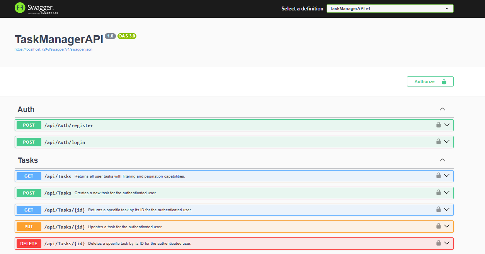

# TaskManager API

A RESTful Web API for managing tasks, built with ASP.NET Core 9 and Entity Framework Core. Features JWT authentication, per-user task isolation, filtering, pagination, and full Swagger documentation.

## Tech Stack

- **Runtime:** .NET 9
- **Framework:** ASP.NET Core Web API
- **ORM:** Entity Framework Core (Code-First)
- **Database:** SQL Server
- **Authentication:** JWT Bearer Tokens
- **Documentation:** Swagger / OpenAPI
- **Testing:** xUnit + Moq

## Features

- User registration and login with BCrypt password hashing
- JWT-based authentication for all task endpoints
- Full CRUD for tasks (Create, Read, Update, Delete)
- Tasks are isolated per user — users can only access their own tasks
- Filter tasks by title and priority
- Pagination with `PagedResult<T>`
- Global error handling middleware (`NotFoundException`, `ConflictException`, `UnauthorizedException`)
- DTOs with data annotations for input validation
- AutoMapper for mapping between models and DTOs
- CORS configured for frontend integration
- Postman collection included

## Project Structure

```
TaskManagerAPI/
├── Controllers/
│   ├── AuthController.cs        # Register & Login
│   └── TasksController.cs       # Task CRUD endpoints
├── Data/
│   └── AppDbContext.cs
├── DTOs/
│   ├── Auth/
│   ├── CreateTaskDto.cs
│   ├── UpdateTaskDto.cs
│   ├── TaskBaseDto.cs
│   └── TaskResponseDto.cs
├── Exceptions/                  # Custom exceptions
├── Mappings/
│   └── MappingProfile.cs
├── Middleware/
│   └── ExceptionMiddleware.cs
├── Migrations/
├── Models/
│   ├── TaskItem.cs
│   ├── User.cs
│   └── PagedResult.cs
├── Services/
│   ├── ITaskService.cs
│   ├── TaskService.cs
│   ├── IAuthService.cs
│   └── AuthService.cs
├── Settings/
│   ├── JwtSettings.cs
│   └── CorsSettings.cs
├── Program.cs
└── appsettings.json

TaskManagerAPI.Tests/
└── TaskServiceTests.cs          # Unit tests (xUnit + Moq)

Postman/                         # Postman collection + environment
```

## Getting Started

### Prerequisites

- [.NET 9 SDK](https://dotnet.microsoft.com/download)
- SQL Server (local or remote instance)
- [EF Core CLI](https://learn.microsoft.com/en-us/ef/core/cli/dotnet): `dotnet tool install --global dotnet-ef`

### Setup

1. **Clone the repository**

```bash
git clone https://github.com/Abdulrahmanhosni/TaskManagerAPI.git
cd TaskManagerAPI
```

2. **Configure your settings**

Copy `appsettings.json` and create `appsettings.Development.json` with your real values:

```json
{
  "ConnectionStrings": {
    "DefaultConnection": "Server=YOUR_SERVER;Database=TaskManagerDB;Trusted_Connection=True;TrustServerCertificate=True"
  },
  "Jwt": {
    "Key": "YOUR_SECRET_KEY_MIN_32_CHARACTERS",
    "ExpiryMinutes": 1440
  },
  "Cors": {
    "AllowedOrigins": [ "http://localhost:YOUR_PORT" ]
  }
}
```

3. **Apply database migrations**

```bash
cd TaskManagerAPI
dotnet ef database update
```

4. **Run the API**

```bash
dotnet run
```

5. **Open Swagger UI**

```

https://localhost:{port}/swagger
```



## API Endpoints

### Auth

| Method | Endpoint | Description | Auth Required |
|--------|----------|-------------|---------------|
| POST | `/api/auth/register` | Register a new user | No |
| POST | `/api/auth/login` | Login and get JWT token | No |

### Tasks

| Method | Endpoint | Description | Auth Required |
|--------|----------|-------------|---------------|
| GET | `/api/tasks` | Get all tasks (filter + pagination) | Yes |
| GET | `/api/tasks/{id}` | Get task by ID | Yes |
| POST | `/api/tasks` | Create a new task | Yes |
| PUT | `/api/tasks/{id}` | Update a task | Yes |
| DELETE | `/api/tasks/{id}` | Delete a task | Yes |

### Query Parameters (GET /api/tasks)

| Parameter | Type | Description |
|-----------|------|-------------|
| `title` | string | Filter by title |
| `priority` | string | Filter by priority (Low / Medium / High) |
| `pageNumber` | int | Page number (default: 1) |
| `pageSize` | int | Items per page (default: 10) |

## Authentication

All task endpoints require a JWT Bearer token.

**Step 1 — Register**
```json
POST /api/auth/register
{
  "username": "abdulrahman",
  "email": "abdulrahman@example.com",
  "password": "YourPassword123!"
}
```

**Step 2 — Login**
```json
POST /api/auth/login
{
  "email": "abdulrahman@example.com",
  "password": "YourPassword123!"
}
```

**Step 3 — Authorize**

In Swagger, click the **Authorize** button 🔒 and enter:
```
Bearer YOUR_TOKEN_HERE
```

Or use Postman — the collection auto-saves the token after login.

## Running the Tests

```bash
cd TaskManagerAPI.Tests
dotnet test
```

The test project uses **xUnit** and **Moq** with an **InMemory database** — no SQL Server connection required to run tests.

Tests cover:
- ✅ Positive case: existing task returns correctly
- ✅ Negative case: non-existing ID throws `NotFoundException`
- ✅ Security case: task belonging to another user throws `NotFoundException`

## Postman

A full Postman collection is included in the `/Postman` folder with:
- Auth and Tasks folders
- Environment variables (`baseUrl`, `token`)
- Auto-save token script on login
- Status code tests on all requests
